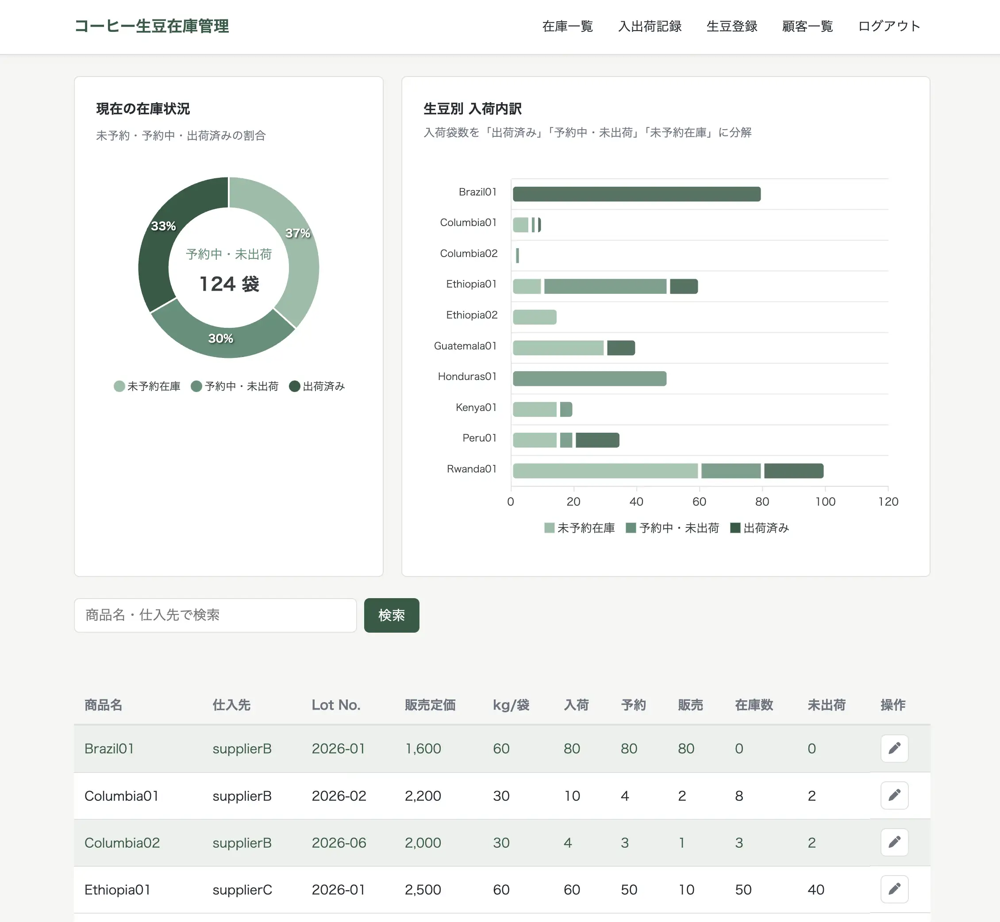

# コーヒー生豆在庫管理



コーヒー生豆の在庫を、銘柄ごとに「入荷・予約・販売」の3種類の記録で管理する業務用Webアプリです。記録を登録するだけで在庫数と未出荷数を自動で集計し、在庫の状況をグラフで確認できます。

- **デモ**：https://gs2026-arakawa.sakura.ne.jp/kadai07_db1/public/login.php
- **テストアカウント**：ログイン情報は個別にお伝えします

お手伝いしているコーヒー生豆の卸売業者さんが、在庫をExcelだけで管理していて苦労されているのを見て作りました。

> このアプリに請求書管理を統合して作り直した後継版があります → [kadai08_db2](https://github.com/Wild-River/kadai08_db2)

---

## 主な機能

### 生豆在庫

- 生豆銘柄（商品名・仕入先・Lot No.・販売定価・1袋あたりの重量）の登録・編集・削除
- 入荷・予約・販売の記録から、銘柄ごとの在庫数と未出荷数を自動で集計
- 在庫が5袋以下の銘柄を一覧で強調表示
- 「未予約在庫」「予約中・未出荷」「出荷済み」の割合をドーナツグラフで、銘柄ごとの内訳を積み上げ棒グラフで表示
- 商品名・仕入先でのキーワード検索と、各列での並べ替え
- 銘柄の編集画面で、その銘柄の入出荷履歴を表示

### 入出荷記録

- 入荷・予約・販売の記録の登録・編集・削除
- 予約・販売の記録には顧客を紐づけ（入荷を選んだときは顧客の入力欄を隠す）
- 在庫を超える販売や、空き在庫を超える予約は登録できないようにチェック

### 顧客

- 顧客（氏名・会社名・メールアドレス・電話番号・備考）の登録・編集・削除
- 顧客の編集画面で、その顧客の購入履歴を表示

### アカウント

- ログイン・ログアウト（セッション認証）
- 30分操作がないと自動でログアウト

---

## 使用技術

| 分類 | 技術 |
|---|---|
| フロントエンド | HTML / CSS / JavaScript / ApexCharts / Font Awesome |
| バックエンド | PHP（フレームワークなし・PDO） |
| データベース | MySQL |
| インフラ | さくらのレンタルサーバー（本番）／ MAMP（ローカル開発） |

### ディレクトリ構成

```
.
├── public/             # 画面（ドキュメントルート）
│   ├── index.php        # 在庫一覧・グラフ
│   ├── bean_*.php       # 生豆銘柄のCRUD
│   ├── movement_*.php   # 入出荷記録のCRUD
│   ├── customer_*.php   # 顧客のCRUD
│   ├── login.php / logout.php
│   ├── css/
│   └── js/              # グラフ描画・ナビゲーションメニュー
└── config/             # DB接続・.env読み込み・ログインチェック・共通関数・ヘッダー
```

---

## DB設計

| テーブル | 内容 |
|---|---|
| `admins` | ログインユーザー |
| `beans` | 生豆銘柄 |
| `stock_movements` | 入出荷記録（入荷・予約・販売）。`beans` と `customers` を参照 |
| `customers` | 顧客 |

---

## 工夫した点

### 在庫の集計

- 在庫数を `beans` テーブルに持たせず、入出荷記録を `SUM(CASE WHEN ...)` で集計して求めています。記録を修正・削除しても在庫数がずれることがありません。
  - 在庫数 ＝ 入荷 − 販売
  - 未出荷 ＝ 予約 − 販売
- `LEFT JOIN` にすることで、入出荷記録がまだない銘柄も在庫0として一覧に表示されます。

### 業務ルールに沿ったチェック

- 販売を記録するときは「在庫（入荷 − 販売）」を、予約を記録するときは「空き在庫（入荷 − 予約）」を超えていないかをサーバー側でチェックし、矛盾するデータが登録されないようにしました。
- 記録を編集するときは、編集中の記録自身を集計から除いてからチェックしています。
- 入荷の記録には顧客を紐づけないよう、画面側で入力欄を隠すだけでなく、サーバー側でも顧客を空にしてから保存しています。

### セキュリティ

- **SQLインジェクション対策**：すべてのクエリでプリペアドステートメント（PDO）を使っています。並べ替えの列名はプレースホルダーにできないため、許可した列名の一覧と照合してからSQLに組み込んでいます。
- **XSS対策**：画面に出力する値はすべて `htmlspecialchars` でエスケープしています。
- **パスワード**：`password_hash` でハッシュ化したものを保存し、`password_verify` で照合しています。
- **セッション固定攻撃対策**：ログイン成功時に `session_regenerate_id` でセッションIDを再発行しています。
- **セッションの有効期限**：最後の操作から30分経つとセッションを破棄し、ログイン画面に戻します。
- DBの接続情報は `.env` に分けて、リポジトリには含めていません。

### 見やすさ・使いやすさ

- 在庫を「未予約在庫 → 予約中・未出荷 → 出荷済み」の段階として捉え、同じ色相の濃淡で塗り分けたグラフにしました。
- 在庫が少ない銘柄は一覧で強調表示して、仕入れのタイミングに気づけるようにしました。
- スマートフォンではヘッダーのメニューをハンバーガーメニューで開閉できます。

---

## 苦労した点

- 在庫・予約の超過チェックなど、複数テーブルにまたがる集計とバリデーションのロジックを整理するのに苦戦しました。「在庫」「空き在庫」「未出荷」がそれぞれ何から計算されるのかを書き出して、業務の流れと照らし合わせながら実装しました。